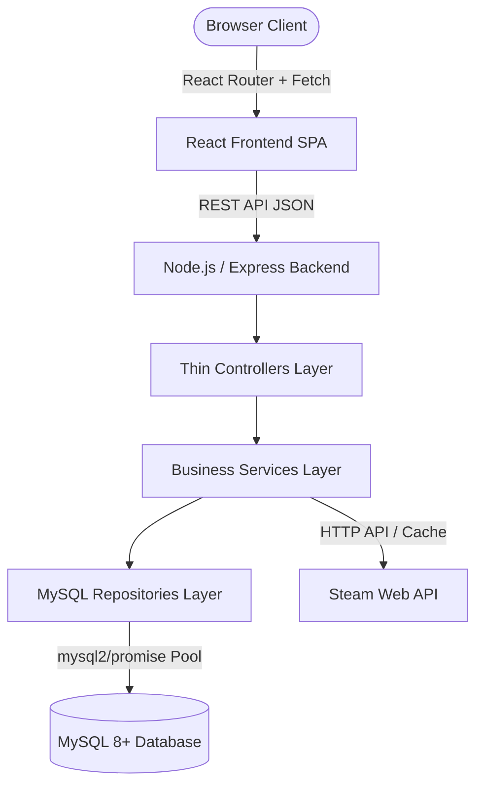
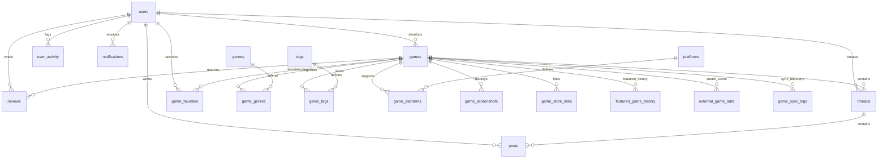

# 🚀 IndieGamer Hub

A full-stack web discovery and community platform connecting independent game developers with players. Features external Steam API integration, rich relational database models in MySQL, real-time community reviews, discussion forums, developer portals, and an admin operations console.

---

## 🏗️ Architecture



---

## 🗄️ Relational Database Design



---

## ⚡ Tech Stack & Interactive Features

- **Frontend**: React 18, React Router 6, Lucide Icons, Vite, Modular CSS (Variables, Gradients, Dark Theme, Micro-animations).
- **Backend**: Node.js, Express.js, `mysql2/promise` connection pooling, JWT Authentication, bcryptjs password hashing.
- **Database**: MySQL 8+ with 20 normalized InnoDB tables, UTF8MB4, foreign key cascades, unique constraints, and indexes.
- **Interactive Playable Demos**: Built-in 8-bit HTML5 Canvas Arcade engine with synthesized retro Web Audio, keyboard controls (jump/dodge), lives, and persistent high scores.
- **Live Community Chat**: Real-time lounges across `#general`, `#dev-talk`, and `#lfg` with verified role badges and localized timestamps.
- **External Integration**: Steam Store Web API with fallback cache and telemetry sync logging.

---

## 🔑 Pre-Seeded Development Accounts

| Role | Email | Password | Username |
|---|---|---|---|
| **Admin** | `admin@indiegamerhub.com` | `Password@123` | `admin_elena` |
| **Developer** | `teamcherry@indiegamerhub.com` | `Password@123` | `teamcherry` |
| **Developer** | `supergiant@indiegamerhub.com` | `Password@123` | `supergiant` |
| **Gamer** | `alex@gamer.com` | `Password@123` | `alex_vance` |
| **Gamer** | `maya@gamer.com` | `Password@123` | `pixel_maya` |

---

## 🚀 Quick Start Guide

### 1. Prerequisites
- **Node.js** (v18+ or v20+)
- **MySQL 8+** running locally on port 3306

### 2. Database Setup
```bash
# In MySQL shell or CLI
CREATE DATABASE IF NOT EXISTS indiegamer_hub CHARACTER SET utf8mb4 COLLATE utf8mb4_unicode_ci;

# Run migrations and seed data
npm run db:migrate
npm run db:seed
```

### 3. Launch Development Servers
```bash
# Terminal 1: Backend API (port 5000)
npm run dev:backend

# Terminal 2: Frontend Vite Client (port 5173)
npm run dev:frontend
```

Open `http://localhost:5173` in your browser.

---

## 🧪 Automated Testing

```bash
# Run backend API unit and integration test suite
npm run test:backend
```

---

## 📅 Frontend Date Standards

All date fields are formatted into natural, user-friendly localized strings:
- **Game Cards & Details**: `"Released Oct 24, 2026"` or `"Releases Nov 28, 2026"`
- **Upcoming Page**: Clear visual calendar date blocks with month, day, and year.
- **Trending Algorithm**: Dynamically calculated from player reviews submitted during the previous 7 days (`WHERE created_at >= NOW() - INTERVAL 7 DAY`).
- **Reviews**: Human-readable dates (`"Oct 8, 2026"`) with `· Edited` indicator when edited.
- **Forum Threads & Posts**: Relative times (`"2 hours ago"`, `"Just now"`) and formatted timestamps (`"Oct 8, 2026 · 7:42 PM"`).
- **User Profiles**: `"Joined October 2026"`.
- **Developer & Admin Dashboards**: Explicit release dates, dates added, last login, and date range picker filters.
