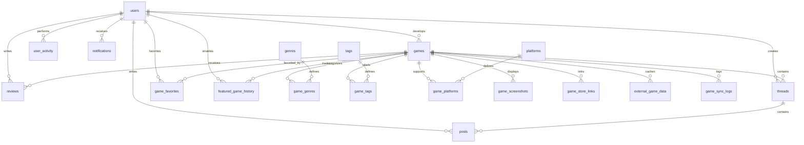

# IndieGamer Hub — Database Documentation

## 1. Overview
IndieGamer Hub utilizes **MySQL 8+** with InnoDB storage engine and `utf8mb4` character set. The application communicates with MySQL using `mysql2/promise` connection pooling.

---

## 2. Entity-Relationship Diagram



---

## 3. Database Commands

```bash
# Run migrations (create tables & indexes)
npm run db:migrate

# Seed development data (Admin, Developers, Gamers, Games, Reviews, Threads)
npm run db:seed

# Full reset: drop tables, migrate, and seed (Development only)
npm run db:reset
```

---

## 4. Key Design Decisions

### Date & Time Handling
- All timestamps in database use UTC (`TIMESTAMP DEFAULT CURRENT_TIMESTAMP` or `DATETIME`).
- `games.release_date` uses `DATE` (calendar day).
- Trending games are queried using `reviews.created_at >= NOW() - INTERVAL 7 DAY`.
- Upcoming games are queried using `release_date > CURDATE() ORDER BY release_date ASC`.
- Frontend translates timestamps into the user's localized format.

### Average Rating Cache
- Whenever a review is created, updated, or deleted, an atomic transaction updates `games.average_rating` and `games.review_count`.

### Authentication & Roles
- Passwords hashed with `bcryptjs`.
- Roles: `gamer`, `developer`, `admin`.
- Development accounts:
  - Admin: `admin@indiegamerhub.com` / `Password@123`
  - Developer: `teamcherry@indiegamerhub.com` / `Password@123`
  - Gamer: `alex@gamer.com` / `Password@123`
